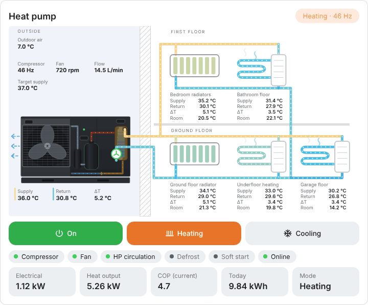
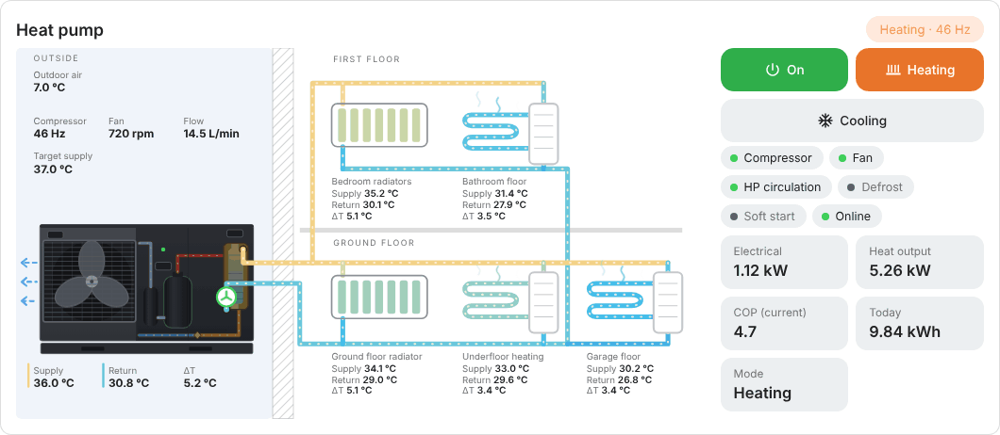
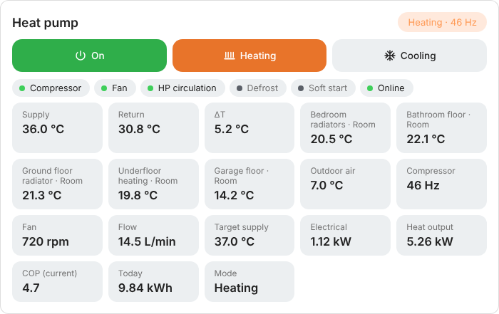

# Panasonic Monoblock Card for Home Assistant

🇳🇱 [Nederlandse versie](README.md)

An animated dashboard card for a **Panasonic monoblock heat pump without a buffer tank** (`custom:panasonic-monoblock-card`). The outdoor unit is drawn as the dark Panasonic monoblock, with the fan behind the grille and, on the right, a look inside at the components: compressor, accumulator, plate heat exchanger and the copper refrigerant lines. The unit is connected straight to the radiators and the underfloor heating. The fan and pumps spin, water flows through the pipes, and pipes and circuits change colour with temperature.

<p align="center">
  <picture>
    <source media="(prefers-color-scheme: dark)" srcset="images/en/monoblock-dark.gif">
    
  </picture>
</p>

<p align="center"><em>Example with demo values. In Home Assistant the animations follow the live status.</em></p>

The look is inspired by [AMensink/warmtepomp-cards](https://github.com/AMensink/warmtepomp-cards) (MIT). The code was written from scratch. The card is available in **Dutch** and **English** and automatically uses the language of your Home Assistant. Animations stop automatically if your device has "reduce motion" enabled.

Do you also have an Atlantic Explorer heat pump water heater? There is a separate card for that: `atlantic-explorer-card`.

---

## Installation

### Via HACS (recommended)

1. Open **HACS** in Home Assistant.
2. Click ⋮ in the top right → **Custom repositories**.
3. Paste the URL of this repository, choose type **Dashboard** and click **Add**.
4. Search for **Panasonic Monoblock Card**, click **Download** and reload the browser (Ctrl+F5).

### Manual

1. Download `dist/panasonic-monoblock-card.js` and place it in `/config/www/`.
2. Go to **Settings → Dashboards → ⋮ → Resources → Add resource**.
3. URL: `/local/panasonic-monoblock-card.js`, type: **JavaScript module**.
4. Reload the browser.

---

## Usage

Edit a dashboard, choose **Add card**, open the card's YAML editor and fill in your own entities under `entities:`. Only what you fill in is shown: missing values, chips and tiles are left out. Click a value in the card to open that entity's details dialog.

```yaml
type: custom:panasonic-monoblock-card
title: Warmtepomp
entities:
  supply: sensor.panasonic_outlet
  return: sensor.panasonic_inlet
  flow: sensor.panasonic_pomp
  power: sensor.panasonic_vermogen
  heat_power: sensor.panasonic_productie
  cop: sensor.panasonic_cop
  comp_hz: sensor.panasonic_compressor
  fan_rpm: sensor.panasonic_ventilator
  ambient: sensor.panasonic_buitentemperatuur
  setpoint: sensor.panasonic_target
  softstart: binary_sensor.wp_softstart_in_uitvoering
  thermostat: climate.woonkamer
  # buttons (optional)
  power_switch: switch.panasonic_heat_pump
  operating_mode: select.panasonic_heat_pump_main_operating_mode_state
  # temperatures per circuit (all optional)
  rad_supply: sensor.radiators_supply
  rad_return: sensor.radiators_return
  bath_supply: sensor.bathroom_floor_supply
  bath_return: sensor.bathroom_floor_return
  floor_supply: sensor.floor_heating_supply
  floor_return: sensor.floor_heating_return
  garage_supply: sensor.garage_supply
  garage_return: sensor.garage_return
  rad_ground_supply: sensor.radiator_downstairs_supply
  rad_ground_return: sensor.radiator_downstairs_return
```

### Options

| Option | Description | Default |
| --- | --- | --- |
| `title` | Card title | by language (`Warmtepomp` / `Heat pump`) |
| `labels` | Your own texts for the card and the buttons, see Language | – |
| `language` | Card language: `nl` or `en`. Defaults to the Home Assistant language | automatic |
| `show_radiators` | Show the radiator circuit | `true` |
| `show_floor` | Show underfloor heating, ground floor | `true` |
| `show_bathroom` | Show the bathroom floor (first floor). `auto` shows it as soon as you fill in `bath_supply` or `bath_return` | `auto` |
| `show_radiators_ground` | Show the radiator on the ground floor. `auto` shows it as soon as you fill in `rad_ground_supply` or `rad_ground_return` | `auto` |
| `show_garage` | Show the garage underfloor heating. `auto` shows it as soon as you fill in `garage_supply` or `garage_return` | `auto` |
| `temp_min` / `temp_max` | Temperature range of the pipe colour scale: blue at or below `temp_min`, red at or above `temp_max`. For underfloor heating try `20` and `40` | `20` / `55` |
| `show_controls` | Show the on/off and heat/cool buttons (only when you fill in `power_switch` / `operating_mode`) | `true` |
| `mode_heat` / `mode_cool` | The options of your `operating_mode` select for heating and cooling | `Heat only` / `Cool only` |
| `view` | `full`, `drawing` or `details`, see below | `full` |
| `layout` | `auto`, `horizontal` or `vertical`, see below | `auto` |
| `reverse_flow` | Reverses all flow animations | `false` |

### Entities

| Key | Meaning |
| --- | --- |
| `supply` / `return` | Supply and return water temperature of the heat pump itself (outlet / inlet). Shown next to the outdoor unit |
| `delta` | ΔT, only needed if you have no supply and return |
| `flow` | Water flow rate (L/min) |
| `power` | Electrical power (W) |
| `heat_power` | Delivered heat output (W). Without it, the card estimates it from flow and ΔT |
| `cop` | COP. Without it, it is calculated from heat output and power |
| `comp_hz` | Compressor frequency |
| `fan_rpm` / `fan_hz` | Fan speed, sets the rotation speed in the drawing |
| `compressor` | Compressor on/off, if there is no frequency sensor |
| `ambient` / `coil` / `exhaust` / `suction` | Outdoor temperature, evaporator, discharge gas and suction gas |
| `hp_sat` / `eev` | Condensing temperature and expansion valve position |
| `defrost` / `online` / `fault` | Defrost, online status and fault |
| `softstart` | Soft start in progress |
| `mode` / `work_mode` | Operating mode and work mode |
| `setpoint` | Target supply temperature |
| `thermostat` | `climate` entity, shows the room temperature |
| `rad_supply` / `rad_return` | Supply and return of the radiators (bedrooms, first floor) |
| `rad_ground_supply` / `rad_ground_return` | Supply and return of the radiator on the ground floor |
| `bath_supply` / `bath_return` | Supply and return of the bathroom underfloor heating (first floor) |
| `floor_supply` / `floor_return` | Supply and return of the ground floor underfloor heating manifold |
| `garage_supply` / `garage_return` | Supply and return of the garage underfloor heating manifold |
| `floor_pump` / `radiator_pump` | Pump switch. If it is off, that circuit turns grey |
| `power_switch` | Switch (`switch`, `input_boolean`) to turn the heat pump on and off. Shows an On/Off button |
| `operating_mode` | `select` entity for the operating mode. Shows the Heat and Cool buttons. Example: `select.panasonic_heat_pump_main_operating_mode_state` |
| `energy_today` | Energy used today (kWh) |

## Landscape screens and separate cards

<p align="center">
  <picture>
    <source media="(prefers-color-scheme: dark)" srcset="images/en/monoblock-horizontal-dark.gif">
    
  </picture>
</p>

On a wide or landscape screen the drawing automatically sits on the left, with the status and values next to it, as soon as the card is about 1000 pixels wide. You can also choose this yourself, or split the card in two:

| Option | Values | Default | What it does |
| --- | --- | --- | --- |
| `layout` | `auto`, `horizontal`, `vertical` | `auto` | Drawing next to or above the details |
| `view` | `full`, `drawing`, `details` | `full` | Everything, only the drawing, or only the details |

<p align="center">
  <picture>
    <source media="(prefers-color-scheme: dark)" srcset="images/en/monoblock-details-dark.png">
    
  </picture>
</p>

For two separate cards side by side, use the same configuration twice:

```yaml
type: horizontal-stack
cards:
  - type: custom:panasonic-monoblock-card
    view: drawing
    entities: { ... }
  - type: custom:panasonic-monoblock-details-card
    entities: { ... }
```

`panasonic-monoblock-details-card` is simply a card with `view: details`. The details card also shows the values that are otherwise in the drawing (supply, return, ΔT, outdoor air, compressor, fan and flow) as tiles. The per-circuit temperatures are only in the drawing.

---

## Good to know

- **Multiple circuits:** the heat pump's own supply and return are shown next to the outdoor unit. Every circuit in the house shows its own supply and return, and its pipes take their colour from those temperatures. A circuit without its own sensors uses the heat pump's temperatures. The heat pump's circulation pump is drawn inside the outdoor unit (bottom right, at the return). Circuits without a pump (such as underfloor heating that hangs straight on the heat pump circulation) do not need a pump sensor: leave out `floor_pump` and it flows as soon as the heat pump circulates.
- **Flow direction:** the supply runs from the heat pump to the radiators and the underfloor heating, and the return runs back to the heat pump. If a direction looks reversed on your setup, set `reverse_flow: true`.
- The COP is an estimate unless you provide `cop` or `heat_power`: flow × 4.186 × ΔT divided by electrical power.
- An entity that does not exist is silently skipped. If a value stays empty, check that the entity ID is correct.

## Language

The card automatically uses the language of your Home Assistant, including the number format (comma or point). **Dutch** and **English** are available; any other language falls back to English. To use a different language than Home Assistant, set `language: nl` or `language: en`. The names of the modes (such as Heat only) come from your own select; set them with `mode_heat` and `mode_cool`.

### Custom texts

With `labels` you change any text on the card, for example the circuit names or the buttons. You only need to give what you want to change:

```yaml
type: custom:panasonic-monoblock-card
labels:
  radBed: Bedrooms
  bath: Bathroom
  heating: Warm
  cooling: Cool
  on: On
  off: Off
  modes:
    heat: Heating
```

Available keys: `supply`, `ret`, `outside`, `first`, `ground`, `defrostBadge`, `ambient`, `coil`, `exhaust`, `suction`, `compressor`, `fan`, `condensing`, `expValve`, `flow`, `target`, `radBed`, `bath`, `radGround`, `floor`, `garage`, `chipCirc`, `chipRadPump`, `chipFloorPump`, `defrost`, `softstart`, `online`, `fault`, `electric`, `heatOut`, `copEst`, `copCur`, `today`, `mode`, `workMode`, `room`, `standby`, `heating`, `cooling`, `on`, `off`. Change the mode names under `modes`.

You can add a language in `dist/panasonic-monoblock-card.js`: copy the `en` block in the `TR` table at the top, give it the language code (for example `de`) and translate the texts. Pull requests are welcome.

## License

MIT
