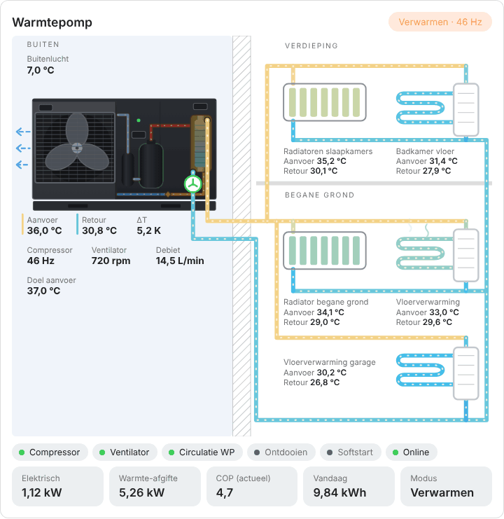
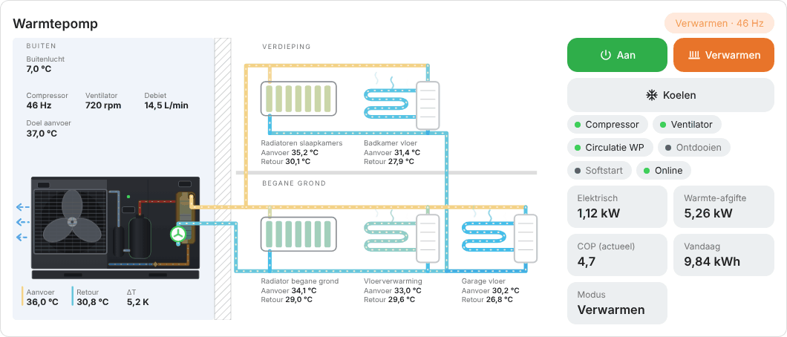
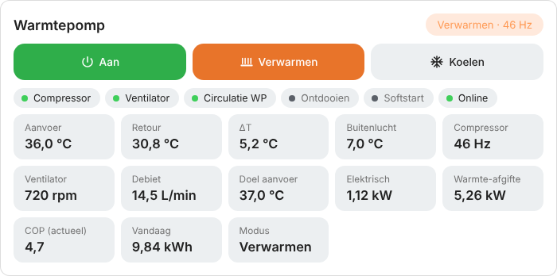

# Panasonic Monoblock Card voor Home Assistant

🇬🇧 [English version](README.en.md)

Een geanimeerde dashboardkaart voor een **Panasonic monoblock-warmtepomp zonder buffervat** (`custom:panasonic-monoblock-card`). De buitenunit is getekend als de donkere Panasonic-monoblock, met de ventilator achter het rooster en rechts een inkijkje in de componenten: compressor, accumulator, platenwisselaar en de koperen koudemiddelleidingen. De unit is rechtstreeks verbonden met de radiatoren en de vloerverwarming. Ventilator en pompen draaien, het water stroomt door de leidingen en leidingen en circuits kleuren mee met de temperatuur.

<p align="center">
  <picture>
    <source media="(prefers-color-scheme: dark)" srcset="images/monoblock-dark.gif">
    
  </picture>
</p>

<p align="center"><em>Voorbeeld met demowaarden. In Home Assistant volgen de animaties de live status.</em></p>

De opmaak is geïnspireerd op [AMensink/warmtepomp-cards](https://github.com/AMensink/warmtepomp-cards) (MIT). De code is opnieuw geschreven. Alle labels zijn in het Nederlands. Animaties stoppen automatisch als je apparaat "verminderde beweging" heeft ingesteld.

Heb je ook een Atlantic Explorer warmtepompboiler? Daar is een aparte kaart voor: `atlantic-explorer-card`.

---

## Installatie

### Via HACS (aanbevolen)

1. Open **HACS** in Home Assistant.
2. Klik rechtsboven op ⋮ → **Aangepaste repositories**.
3. Plak de URL van deze repository, kies type **Dashboard** en klik **Toevoegen**.
4. Zoek **Panasonic Monoblock Card**, klik **Downloaden** en herlaad de browser (Ctrl+F5).

### Handmatig

1. Download `dist/panasonic-monoblock-card.js` en zet het in `/config/www/`.
2. Ga naar **Instellingen → Dashboards → ⋮ → Resources → Resource toevoegen**.
3. URL: `/local/panasonic-monoblock-card.js`, type: **JavaScript-module**.
4. Herlaad de browser.

---

## Gebruik

Bewerk een dashboard, kies **Kaart toevoegen**, open de YAML-editor van de kaart en vul je eigen entiteiten in onder `entities:`. Alleen wat je invult wordt getoond: ontbrekende waarden, chips en tegels worden weggelaten. Klik in de kaart op een waarde om het detailvenster van die entiteit te openen.

```yaml
type: custom:panasonic-monoblock-card
title: Warmtepomp
entities:
  supply: sensor.panasonic_outlet
  return: sensor.panasonic_inlet
  flow: sensor.panasonic_pomp
  power: sensor.panasonic_vermogen
  heat_power: sensor.panasonic_productie
  cop: sensor.panasonic_cop
  comp_hz: sensor.panasonic_compressor
  fan_rpm: sensor.panasonic_ventilator
  ambient: sensor.panasonic_buitentemperatuur
  setpoint: sensor.panasonic_target
  softstart: binary_sensor.wp_softstart_in_uitvoering
  thermostat: climate.woonkamer
  # temperaturen per circuit (allemaal optioneel)
  rad_supply: sensor.radiatoren_aanvoer
  rad_return: sensor.radiatoren_retour
  bath_supply: sensor.badkamer_vloer_aanvoer
  bath_return: sensor.badkamer_vloer_retour
  floor_supply: sensor.vloerverwarming_aanvoer
  floor_return: sensor.vloerverwarming_retour
  garage_supply: sensor.garage_aanvoer
  garage_return: sensor.garage_retour
  rad_ground_supply: sensor.radiator_beneden_aanvoer
  rad_ground_return: sensor.radiator_beneden_retour
```

### Opties

| Optie | Omschrijving | Standaard |
| --- | --- | --- |
| `title` | Titel van de kaart | `Warmtepomp` |
| `show_radiators` | Radiatorcircuit tonen | `true` |
| `show_floor` | Vloerverwarming begane grond tonen | `true` |
| `show_bathroom` | Badkamervloer (verdieping) tonen. `auto` toont hem zodra je `bath_supply` of `bath_return` invult | `auto` |
| `show_radiators_ground` | Radiator op de begane grond tonen. `auto` toont hem zodra je `rad_ground_supply` of `rad_ground_return` invult | `auto` |
| `show_garage` | Vloerverwarming garage tonen. `auto` toont hem zodra je `garage_supply` of `garage_return` invult | `auto` |
| `view` | `full`, `drawing` of `details`, zie hieronder | `full` |
| `layout` | `auto`, `horizontal` of `vertical`, zie hieronder | `auto` |
| `reverse_flow` | Draait alle stroomanimaties om | `false` |

### Entiteiten

| Sleutel | Betekenis |
| --- | --- |
| `supply` / `return` | Aanvoer- en retourtemperatuur van de warmtepomp zelf (outlet / inlet). Staan bij de buitenunit |
| `delta` | ΔT, alleen nodig als je geen aanvoer en retour hebt |
| `flow` | Waterdebiet (L/min) |
| `power` | Elektrisch vermogen (W) |
| `heat_power` | Geleverd warmtevermogen (W). Zonder deze sensor schat de kaart het uit debiet en ΔT |
| `cop` | COP. Zonder deze sensor wordt hij berekend uit warmte-afgifte en vermogen |
| `comp_hz` | Compressorfrequentie |
| `fan_rpm` / `fan_hz` | Ventilatorsnelheid, bepaalt de draaisnelheid in de tekening |
| `compressor` | Compressor aan/uit, als er geen frequentie is |
| `ambient` / `coil` / `exhaust` / `suction` | Buitentemperatuur, verdamper, persgas en zuiggas |
| `hp_sat` / `eev` | Condensatietemperatuur en positie expansieventiel |
| `defrost` / `online` / `fault` | Ontdooien, online-status en storing |
| `softstart` | Softstart in uitvoering |
| `mode` / `work_mode` | Bedrijfsmodus en werkstand |
| `setpoint` | Gewenste aanvoertemperatuur |
| `thermostat` | `climate`-entiteit, toont de kamertemperatuur |
| `rad_supply` / `rad_return` | Aanvoer en retour van de radiatoren (slaapkamers, verdieping) |
| `rad_ground_supply` / `rad_ground_return` | Aanvoer en retour van de radiator op de begane grond |
| `bath_supply` / `bath_return` | Aanvoer en retour van de vloerverwarming in de badkamer (verdieping) |
| `floor_supply` / `floor_return` | Aanvoer en retour van de verdeler van de vloerverwarming op de begane grond |
| `garage_supply` / `garage_return` | Aanvoer en retour van de vloerverwarmingsverdeler in de garage |
| `floor_pump` / `radiator_pump` | Schakelaar van de pomp. Staat die uit, dan wordt het circuit grijs |
| `energy_today` | Verbruik vandaag (kWh) |

## Liggend scherm of losse kaarten

<p align="center">
  <picture>
    <source media="(prefers-color-scheme: dark)" srcset="images/monoblock-horizontal-dark.gif">
    
  </picture>
</p>

Op een breed of liggend scherm staat de tekening vanzelf links en staan de status en de waarden rechts ernaast, zodra de kaart ongeveer 920 pixels breed is. Je kunt dat ook zelf kiezen, of de kaart in tweeën splitsen:

| Optie | Waarden | Standaard | Wat het doet |
| --- | --- | --- | --- |
| `layout` | `auto`, `horizontal`, `vertical` | `auto` | Tekening naast of boven de details |
| `view` | `full`, `drawing`, `details` | `full` | Alles, alleen de tekening, of alleen de details |

<p align="center">
  <picture>
    <source media="(prefers-color-scheme: dark)" srcset="images/monoblock-details-dark.png">
    
  </picture>
</p>

Voor twee losse kaarten naast elkaar gebruik je dezelfde configuratie twee keer:

```yaml
type: horizontal-stack
cards:
  - type: custom:panasonic-monoblock-card
    view: drawing
    entities: { ... }
  - type: custom:panasonic-monoblock-details-card
    entities: { ... }
```

`panasonic-monoblock-details-card` is gewoon een kaart met `view: details`. In de detailkaart staan ook de waarden die anders in de tekening staan (aanvoer, retour, ΔT, buitenlucht, compressor, ventilator en debiet) als tegels. De temperaturen per circuit staan alleen in de tekening, behalve die van de garage.

**De garage verhuist mee.** Bij een liggende weergave (en dus ook bij `layout: auto` op een breed scherm) staat de garage als los blok rechts, onder de waarden. Bij `view: drawing` staat de garage niet in de tekening, maar in de detailkaart (`view: details`), zodat hij bij een gesplitste opstelling maar één keer voorkomt. Heb je alleen de tekening nodig, zet dan `show_garage: false`.

---

## Goed om te weten

- **Meerdere circuits:** de aanvoer en retour van de warmtepomp staan bij de buitenunit. Elk circuit in het huis toont zijn eigen aanvoer en retour, en zijn leidingen kleuren mee met die eigen temperaturen. Een circuit zonder eigen sensoren gebruikt de temperaturen van de warmtepomp. De circulatiepomp van de warmtepomp zit in de buitenunit getekend (rechtsonder, bij de retour). Circuits zonder pomp (zoals vloerverwarming die rechtstreeks aan de warmtepompcirculatie hangt) hebben geen pompsensor nodig: laat `floor_pump` weg, dan stroomt het zodra de warmtepomp circuleert.
- **Stroomrichting:** de aanvoer loopt van de warmtepomp naar de radiatoren en de vloerverwarming, de retour loopt terug naar de warmtepomp. Staat een richting bij jou toch omgekeerd, zet dan `reverse_flow: true`.
- De COP is een schatting als je geen `cop` of `heat_power` opgeeft: debiet × 4,186 × ΔT gedeeld door het elektrisch vermogen.
- Een entiteit die niet bestaat, wordt stilletjes overgeslagen. Controleer bij een lege waarde of de entiteit-ID klopt.

## Licentie

MIT
